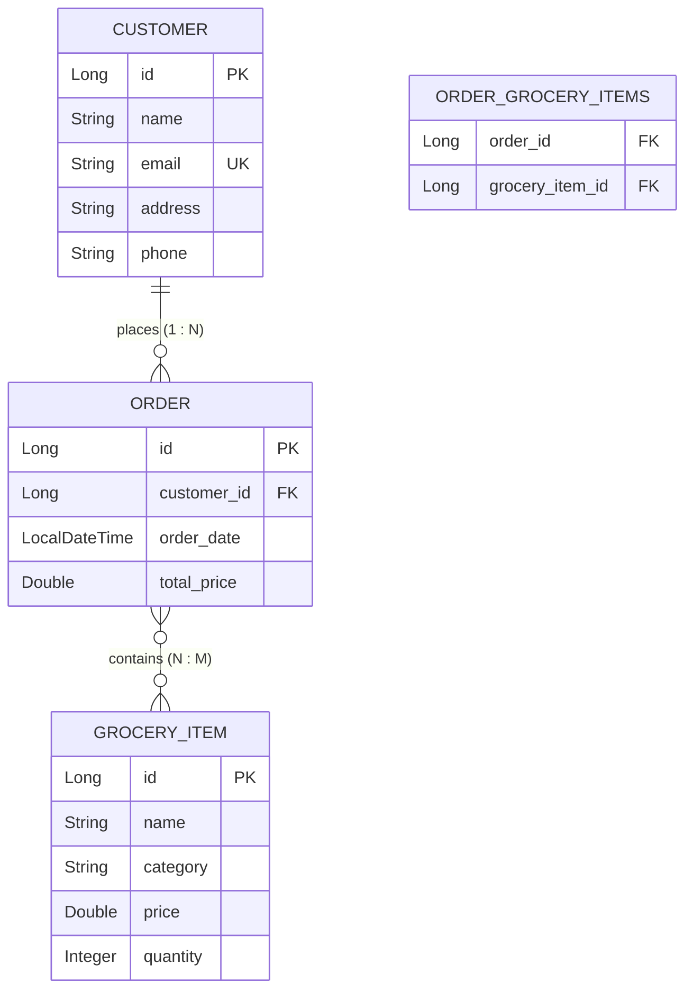

# Online Grocery Ordering System - RESTful API

A robust RESTful API service built with **Spring Boot 3**, **Spring Data JPA**, and **Hibernate** for managing an online grocery ordering system. The service provides full CRUD operations for Customers, Grocery Items, and Orders, with validation, global error handling, OpenAPI/Swagger documentation, and an automated test suite.

---

## 📋 Table of Contents
- [Features](#-features)
- [Tech Stack](#-tech-stack)
- [Domain Model & Relationships](#-domain-model--relationships)
- [Project Structure](#-project-structure)
- [Getting Started](#-getting-started)
  - [Prerequisites](#prerequisites)
  - [Running the Application (H2 Database)](#running-the-application-h2-database)
  - [Running with MySQL Database](#running-with-mysql-database)
- [API Documentation (Swagger UI) & H2 Console](#-api-documentation-swagger-ui--h2-console)
- [API Endpoints Reference](#-api-endpoints-reference)
  - [Customer Management](#customer-management)
  - [Grocery Item Management](#grocery-item-management)
  - [Order Management](#order-management)
- [Sample Payloads & Curl Requests](#-sample-payloads--curl-requests)
- [Error Handling & HTTP Status Codes](#-error-handling--http-status-codes)
- [Running Unit & Integration Tests](#-running-unit--integration-tests)
- [Postman Collection](#-postman-collection)
- [Git Repository Setup](#-git-repository-setup)

---

## ✨ Features

- **Customer Management**:
  - Store customer information: Name, Email (unique), Address, Phone.
  - Complete CRUD operations with email format & unique constraint validation.
- **Grocery Item Management**:
  - Manage inventory items: Name, Category, Price, Stock Quantity.
  - CRUD operations with optional category filtering (`/api/grocery-items?category=Dairy`).
- **Order Management**:
  - Track orders placed by customers for grocery items.
  - Supports automatic total price calculation or explicit price entry.
  - Automatic timestamp assignment.
  - Query orders by customer ID.
- **Global Error Handling**:
  - Centralized `@RestControllerAdvice` delivering structured error JSON for `404 Not Found`, `400 Bad Request`, `409 Conflict`, and `500 Internal Server Error`.
- **Preloaded Seed Data**:
  - Built-in `CommandLineRunner` populates demo customers, grocery items, and orders on initial startup for instant testing.
- **Interactive Documentation**:
  - Integrated OpenAPI 3.0 (Swagger UI) for interactive endpoint exploration and testing.
- **Automated Testing**:
  - Comprehensive unit and WebMvc tests with Mockito and JUnit 5 covering service logic and controller validation.

---

## 🛠 Tech Stack

- **Java**: 21+ (Compatible with JDK 21 & 23)
- **Framework**: Spring Boot 3.4.2
- **Persistence**: Spring Data JPA, Hibernate ORM
- **Validation**: Jakarta Validation (`@Valid`, `@NotBlank`, `@Email`, `@Positive`, etc.)
- **Databases**:
  - **H2**: In-Memory database for quick development and zero-config testing (Default)
  - **MySQL**: Production-ready relational database support (Configurable profile)
- **API Documentation**: Springdoc OpenAPI 2.8.5 (Swagger UI)
- **Testing**: JUnit 5, Mockito, Spring Boot Test (`MockMvc`, `@MockitoBean`)
- **Build Tool**: Maven Wrapper (`./mvnw` / `mvnw.cmd`)

---

## 📊 Domain Model & Relationships

The system models three core entities and their relationships:

1. **Customer**: Can place multiple orders (**1-to-Many** with `Order`).
2. **Order**: Tracks orders placed by a customer for grocery items (**Many-to-1** with `Customer`, **Many-to-Many** with `GroceryItem`).
3. **Grocery Item**: Can be part of multiple orders (**Many-to-Many** with `Order`).



---

## 📁 Project Structure

```
onlineGroceryOrderingSystem/
├── .mvn/wrapper/                       # Maven Wrapper files
├── src/
│   ├── main/
│   │   ├── java/com/crio/onlinegrocery/
│   │   │   ├── config/
│   │   │   │   ├── DataInitializer.java     # Seeds initial demo data
│   │   │   │   └── OpenApiConfig.java       # OpenAPI / Swagger configuration
│   │   │   ├── controller/
│   │   │   │   ├── CustomerController.java  # Customer REST endpoints
│   │   │   │   ├── GroceryItemController.java# Grocery items REST endpoints
│   │   │   │   └── OrderController.java     # Order REST endpoints
│   │   │   ├── dto/
│   │   │   │   ├── CustomerRequestDto.java
│   │   │   │   ├── CustomerResponseDto.java
│   │   │   │   ├── GroceryItemRequestDto.java
│   │   │   │   ├── GroceryItemResponseDto.java
│   │   │   │   ├── OrderRequestDto.java
│   │   │   │   └── OrderResponseDto.java
│   │   │   ├── entity/
│   │   │   │   ├── Customer.java            # JPA entity: Customer
│   │   │   │   ├── GroceryItem.java         # JPA entity: GroceryItem
│   │   │   │   └── Order.java               # JPA entity: Order
│   │   │   ├── exception/
│   │   │   │   ├── BadRequestException.java
│   │   │   │   ├── DuplicateResourceException.java
│   │   │   │   ├── ErrorResponse.java       # Standard error format
│   │   │   │   ├── GlobalExceptionHandler.java
│   │   │   │   └── ResourceNotFoundException.java
│   │   │   ├── repository/
│   │   │   │   ├── CustomerRepository.java
│   │   │   │   ├── GroceryItemRepository.java
│   │   │   │   └── OrderRepository.java
│   │   │   ├── service/
│   │   │   │   ├── CustomerService.java
│   │   │   │   ├── GroceryItemService.java
│   │   │   │   ├── OrderService.java
│   │   │   │   └── impl/
│   │   │   │       ├── CustomerServiceImpl.java
│   │   │   │       ├── GroceryItemServiceImpl.java
│   │   │   │       └── OrderServiceImpl.java
│   │   │   └── OnlineGroceryApplication.java
│   │   └── resources/
│   │       ├── application.properties       # Default profile: H2 in-memory DB
│   │       └── application-mysql.properties # MySQL profile configuration
│   └── test/
│       └── java/com/crio/onlinegrocery/
│           ├── OnlineGroceryApplicationTests.java
│           ├── controller/
│           │   ├── CustomerControllerTest.java
│           │   ├── GroceryItemControllerTest.java
│           │   └── OrderControllerTest.java
│           └── service/
│               ├── CustomerServiceTest.java
│               ├── GroceryItemServiceTest.java
│               └── OrderServiceTest.java
├── Online_Grocery_Ordering_System.postman_collection.json # Exported Postman collection
├── pom.xml                                  # Maven dependencies & build setup
├── mvnw / mvnw.cmd                          # Maven wrappers for Linux/macOS and Windows
└── README.md
```

---

## 🚀 Getting Started

### Prerequisites
- **Java Development Kit (JDK)**: Version 21 or 23 installed
- **Git**

### Running the Application (H2 Database)
The application is preconfigured to run out-of-the-box with an in-memory H2 database. No database installation is required!

1. Open a terminal in the project directory:
   ```bash
   # Windows (PowerShell / Command Prompt)
   .\mvnw.cmd spring-boot:run

   # Linux / macOS
   ./mvnw spring-boot:run
   ```
2. The server will start on port `8080`.

### Running with MySQL Database
If you prefer to use MySQL:

1. Ensure MySQL is running on `localhost:3306`.
2. Update database credentials in `src/main/resources/application-mysql.properties` if needed:
   ```properties
   spring.datasource.url=jdbc:mysql://localhost:3306/grocery_db?createDatabaseIfNotExist=true&useSSL=false&allowPublicKeyRetrieval=true&serverTimezone=UTC
   spring.datasource.username=root
   spring.datasource.password=root
   ```
3. Run the application with the `mysql` profile:
   ```bash
   .\mvnw.cmd spring-boot:run -Dspring-boot.run.profiles=mysql
   ```

---

## 🌐 API Documentation (Swagger UI) & H2 Console

- **Swagger UI (Interactive API Explorer)**:  
  [http://localhost:8080/swagger-ui.html](http://localhost:8080/swagger-ui.html)
- **OpenAPI 3.0 JSON Specification**:  
  [http://localhost:8080/v3/api-docs](http://localhost:8080/v3/api-docs)
- **H2 Web Console**:  
  [http://localhost:8080/h2-console](http://localhost:8080/h2-console)  
  - JDBC URL: `jdbc:h2:mem:grocerydb`
  - Username: `sa`
  - Password: *(leave blank)*

---

## 📡 API Endpoints Reference

### Customer Management

| Method | Endpoint | Description | Status Code |
| :--- | :--- | :--- | :--- |
| `POST` | `/api/customers` | Register a new customer | `201 Created` |
| `GET` | `/api/customers` | Retrieve all customers | `200 OK` |
| `GET` | `/api/customers/{id}` | Retrieve customer by ID | `200 OK` / `404 Not Found` |
| `PUT` | `/api/customers/{id}` | Update customer information | `200 OK` / `404 Not Found` |
| `DELETE` | `/api/customers/{id}` | Delete a customer | `204 No Content` / `404 Not Found` |

### Grocery Item Management

| Method | Endpoint | Description | Status Code |
| :--- | :--- | :--- | :--- |
| `POST` | `/api/grocery-items` | Add a new grocery item | `201 Created` |
| `GET` | `/api/grocery-items` | Get all grocery items (or filter by `?category=...`) | `200 OK` |
| `GET` | `/api/grocery-items/{id}` | Retrieve grocery item by ID | `200 OK` / `404 Not Found` |
| `PUT` | `/api/grocery-items/{id}` | Update grocery item details | `200 OK` / `404 Not Found` |
| `DELETE` | `/api/grocery-items/{id}` | Remove grocery item from inventory | `204 No Content` / `404 Not Found` |

### Order Management

| Method | Endpoint | Description | Status Code |
| :--- | :--- | :--- | :--- |
| `POST` | `/api/orders` | Place a new grocery order | `201 Created` |
| `GET` | `/api/orders` | Retrieve all orders | `200 OK` |
| `GET` | `/api/orders/{id}` | Retrieve order details by ID | `200 OK` / `404 Not Found` |
| `GET` | `/api/orders/customer/{customerId}` | Retrieve all orders for a specific customer | `200 OK` / `404 Not Found` |
| `PUT` | `/api/orders/{id}` | Update order details | `200 OK` / `404 Not Found` |
| `DELETE` | `/api/orders/{id}` | Cancel/delete an order | `204 No Content` / `404 Not Found` |

---

## 💻 Sample Payloads & Curl Requests

### 1. Create a Customer
```bash
curl -X POST http://localhost:8080/api/customers \
  -H "Content-Type: application/json" \
  -d '{
    "name": "Sarah Connor",
    "email": "sarah.connor@example.com",
    "address": "742 Evergreen Terrace, Springfield",
    "phone": "+1-555-0144"
  }'
```

**Response (`201 Created`):**
```json
{
  "id": 4,
  "name": "Sarah Connor",
  "email": "sarah.connor@example.com",
  "address": "742 Evergreen Terrace, Springfield",
  "phone": "+1-555-0144"
}
```

### 2. Create a Grocery Item
```bash
curl -X POST http://localhost:8080/api/grocery-items \
  -H "Content-Type: application/json" \
  -d '{
    "name": "Almond Milk 1L",
    "category": "Dairy",
    "price": 3.79,
    "quantity": 30
  }'
```

**Response (`201 Created`):**
```json
{
  "id": 6,
  "name": "Almond Milk 1L",
  "category": "Dairy",
  "price": 3.79,
  "quantity": 30
}
```

### 3. Place an Order
> Note: If `totalPrice` is omitted, the API will automatically calculate it from the sum of item prices. If `orderDate` is omitted, the current date/time is used.

```bash
curl -X POST http://localhost:8080/api/orders \
  -H "Content-Type: application/json" \
  -d '{
    "customerId": 1,
    "groceryItemIds": [1, 2, 4]
  }'
```

**Response (`201 Created`):**
```json
{
  "id": 3,
  "customer": {
    "id": 1,
    "name": "Alice Smith",
    "email": "alice.smith@example.com",
    "address": "123 Oak Street, Springfield",
    "phone": "+1-555-0101"
  },
  "groceryItems": [
    {
      "id": 1,
      "name": "Whole Milk 1L",
      "category": "Dairy",
      "price": 3.49,
      "quantity": 50
    },
    {
      "id": 2,
      "name": "Whole Wheat Bread",
      "category": "Bakery",
      "price": 2.99,
      "quantity": 40
    },
    {
      "id": 4,
      "name": "Honeycrisp Apples (1kg)",
      "category": "Produce",
      "price": 5.49,
      "quantity": 35
    }
  ],
  "orderDate": "2026-11-16T17:45:00",
  "totalPrice": 11.97
}
```

---

## 🛡 Error Handling & HTTP Status Codes

The API employs a centralized exception handler returning clean, standardized JSON objects:

```json
{
  "timestamp": "2026-11-16T17:50:00.123456",
  "status": 404,
  "error": "Not Found",
  "message": "Customer not found with id: 99",
  "path": "/api/customers/99"
}
```

When validation fails (`400 Bad Request`), detailed field errors are provided:

```json
{
  "timestamp": "2026-11-16T17:50:00.123456",
  "status": 400,
  "error": "Bad Request",
  "message": "Validation failed for one or more fields",
  "path": "/api/customers",
  "validationErrors": {
    "email": "Customer email must be valid",
    "name": "Customer name is required"
  }
}
```

| HTTP Status | Meaning | Scenario |
| :--- | :--- | :--- |
| `200 OK` | Request succeeded | Successful GET, PUT |
| `201 Created` | Resource created | Successful POST |
| `204 No Content` | Deleted | Successful DELETE |
| `400 Bad Request` | Invalid input | Validation error, malformed JSON |
| `404 Not Found` | Entity not found | Querying non-existent customer, item, or order |
| `409 Conflict` | Constraint violation | Attempting to register duplicate email |
| `500 Server Error` | Unexpected error | Generic unhandled exceptions |

---

## 🧪 Running Unit & Integration Tests

All 45 automated tests (Service unit tests, MockMvc controller tests, and context tests) can be executed using the Maven wrapper:

```bash
# Windows
.\mvnw.cmd test

# Linux / macOS
./mvnw test
```

### Test Suite Summary:
- **Service Tests**: Validates business logic, DTO mapping, pricing calculations, and exception raising.
- **Controller Tests**: Validates HTTP status codes, routing, request JSON deserialization, validation errors, and response formatting using `MockMvc`.
- **Application Test**: Verifies Spring application context bootstrapping and data seed initialization.

---

## 📮 Postman Collection

A ready-to-import Postman collection is included in the root directory:
- File: [`Online_Grocery_Ordering_System.postman_collection.json`](./Online_Grocery_Ordering_System.postman_collection.json)

**To use it:**
1. Open Postman.
2. Click **Import** in the top left.
3. Select `Online_Grocery_Ordering_System.postman_collection.json`.
4. The collection is preconfigured with the variable `baseUrl = http://localhost:8080`.
5. Run the requests to interact with Customers, Items, Orders, and Error Scenarios!

---

## 🐙 Git Repository Setup

To commit your project and push it to a new GitHub repository:

```bash
# 1. Initialize Git repository
git init

# 2. Add all files to staging
git add .

# 3. Create initial commit
git commit -m "feat: complete online grocery ordering system REST API"

# 4. Create repository on GitHub, then link and push:
git branch -M main
git remote add origin https://github.com/<YOUR_USERNAME>/<YOUR_REPOSITORY_NAME>.git
git push -u origin main
```
